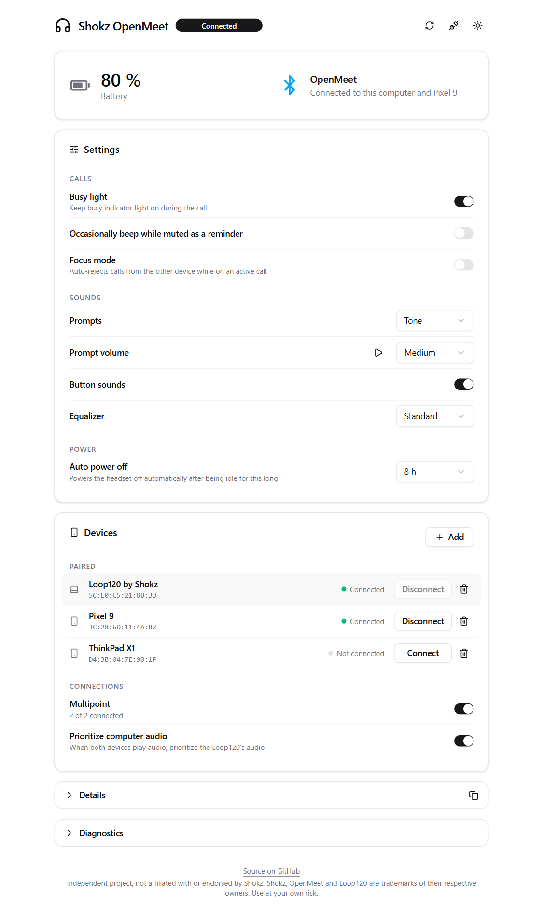

# OpenMeet Web

Control panel for the Shokz OpenMeet headset through its Loop120 USB dongle, running entirely in the browser over [WebHID](https://developer.mozilla.org/docs/Web/API/WebHID_API). No install, no driver, no account.

<picture>
  <source media="(prefers-color-scheme: dark)" srcset="docs/screenshot-dark.png">
  
</picture>

- See the current headset status (battery, devices paired, etc.)
- Access to standard headset settings: equalizer, prompts and prompt volume, button sounds, busy light, mute reminder, focus mode, auto power off, multipoint, computer-audio priority
- Pairing list: connect, disconnect and forget devices, put the headset in pairing mode, connect a brand new Loop120 with a headset
- Detailed diagnostics log for those who like to tinker

Supported: OpenMeet (C610). OpenMeet 2 (C62x) is supported on a best-effort basis.

## Usage

Open the page in Chrome or Edge (WebHID is currently unavailable in Firefox or Safari), plug in your Loop120 dongle, and select **Connect dongle**. The browser will prompt you to select your Loop120 dongle. If you have the Shokz Connect app installed, please ensure to exit it entirely before using this tool as they will conflict.

## Development

```sh
npm install
npm run dev    # standard Vite test server
npm run build  # build to dist/index.html
```

`dev/fake-hid.js` is a simulated dongle and headset. Inject as an init script (e.g. with Puppeteer's `evaluateOnNewDocument`) for testing the UI without hardware.

## How it works

The dongle exposes a HID collection (usage page `0x0C`, usage `0x01`) that carries a small vendor protocol alongside the ordinary media keys. Each command is a framed, CRC-checked TLV sent on output report `0x12` (dongle) or `0x14` (headset); replies and unsolicited notifications arrive on `0x13` / `0x15`. Headset commands are relayed by the dongle over a Bluetooth SPP channel.

- `src/protocol/frames.ts`: constants, framing, CRC, notification decoding
- `src/protocol/dongle.ts`: WebHID transport: one request at a time, replies matched by tag
- `src/protocol/commands.ts`: the commands and how their replies are read
- `src/store.ts`: application state and the actions the UI calls
- `src/components/`: the interface (React, Tailwind, shadcn/ui)

## License

[Standard MIT License](LICENSE)
